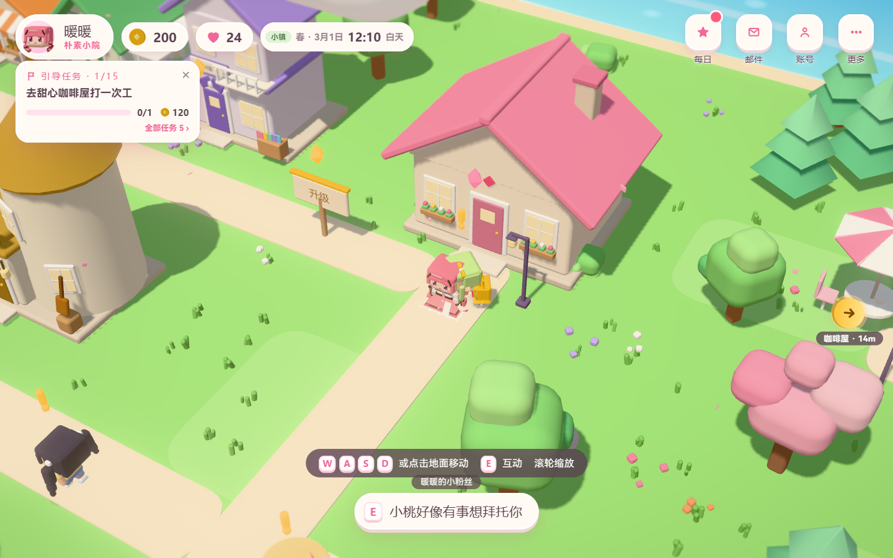

# 暖暖的方块小镇

一款用 Three.js 和原生 JavaScript 编写的方块风 3D 模拟经营同人游戏。可以在小镇打工、种田、钓鱼、换装、布置家园，也可以在建筑岛搭建房屋。

这是非官方玩家作品，与叠纸游戏（Papergames）无关联或授权关系。项目原创代码采用 MIT 许可证；角色形象、名称、商标等第三方权利不在代码许可证的授权范围内，详见下方说明。

游戏仅支持横屏。手机请横向游玩；竖持时网页会显示旋转提示并暂停游戏，转回横屏后继续。Android 安装版固定为横屏，设置中不再提供竖屏或自动方向选项。



## 本地运行

安装 **Node.js 24 或更高版本**。在仓库目录执行：

```sh
npm ci
npm start
```

打开 <http://localhost:5173>。开发入口使用浏览器原生 ES Module，无需先构建；直接双击 `index.html` 无法替代 HTTP 服务器。服务器默认只监听本机。

本机 `localhost:5173` / `127.0.0.1:5173` 默认进入自由试玩，使用独立存档位；访问 <http://localhost:5173/?sandbox=0> 可体验正常经营进度。浏览器存档保存在本机 localStorage，游客可以游玩，游戏设置中提供存档导出和导入。

`npm start` 同时提供可选的本地账号 API，首次运行会在 `data/` 创建 SQLite 数据库。公开源码不包含已有账号、玩家存档、支付密钥、签名私钥或生产环境配置。自己部署账号服务时应配置自己的服务器地址与环境变量，详情见 [构建与运行说明](docs/BUILD.md)。

## 玩法

- 咖啡店、花店、裁缝店、钓鱼和面包房等小游戏。
- 种植、收获、家园扩建、家具摆放与房屋建造。
- 换装、居民互动、任务、节日活动、拍照与钢琴。
- 本地存档导入/导出；可选的自托管账号、云存档及邮件服务。
- Electron 桌面外壳和 Capacitor Android 工程。

角色、场景、家具主要由代码创建几何模型；音效与背景音乐由 WebAudio 合成。网页游戏的 npm 运行依赖是 Three.js。

## 检查与构建

```sh
npm run check
npm test
```

检查覆盖源码语法、入口资源完整性、任务逻辑和自由试玩存档隔离。它们使用内存测试夹具，不读写真实玩家存档，也不会访问线上账号服务。测试报告写入被 Git 忽略的 `output/`。

安装 **Python 3** 后生成纯静态网页目录：

```sh
npm run build
python -m http.server 5173 --bind 127.0.0.1 --directory dist
```

执行预览前先停止占用 5173 端口的开发服务器。构建只重建仓库内的 `dist/`；目录包含运行时模块及许可证，可部署到支持静态文件的主机。纯静态托管默认仅提供本地游玩；账号和云存档需另外部署 API。

Windows / Android 需要各自的工具链，具体步骤及打包边界见 [docs/BUILD.md](docs/BUILD.md)。仓库中的原生项目源码不代表提供了已签名、已安装验证或已发布的安装包。

## 目录

| 路径 | 内容 |
| --- | --- |
| `index.html`、`css/` | 网页入口与样式 |
| `js/` | 游戏状态、玩法、模型、场景和界面 |
| `server.js`、`server-api.js`、`server/` | 开发服务器与可选账号、云存档及邮件 API |
| `desktop/` | Electron 外壳与资源更新代码 |
| `apk/` | Capacitor Android 工程 |
| `tools/` | 构建工具、源码检查和选定的离线回归测试 |
| `docs/BUILD.md` | 环境、构建与自行部署说明 |

## 许可证与同人内容

本项目贡献者有权许可的原创代码和文档采用 [MIT License](LICENSE)，允许在遵守许可证的条件下使用、修改、再分发及商业使用这些代码。依赖库仍适用各自许可证，参见 [THIRD_PARTY_NOTICES.md](THIRD_PARTY_NOTICES.md)。

暖暖、大喵等角色形象，以及相关名称、世界观表达与商标，涉及叠纸游戏及其他权利人的权利。这些第三方权利没有通过本仓库的 MIT 许可证授予。代码的开放许可不等于取得使用原作角色、名称、商标或其他受保护内容的授权，也不表示权利人认可本项目。分发自己的衍生作品时，请自行处理相关权利，或将相关内容替换为有权使用的原创内容。

本仓库提供游戏源码及构建所需工程，不包含官方图片、官方模型、原作音频文件、原项目的运营数据或发布凭据。
